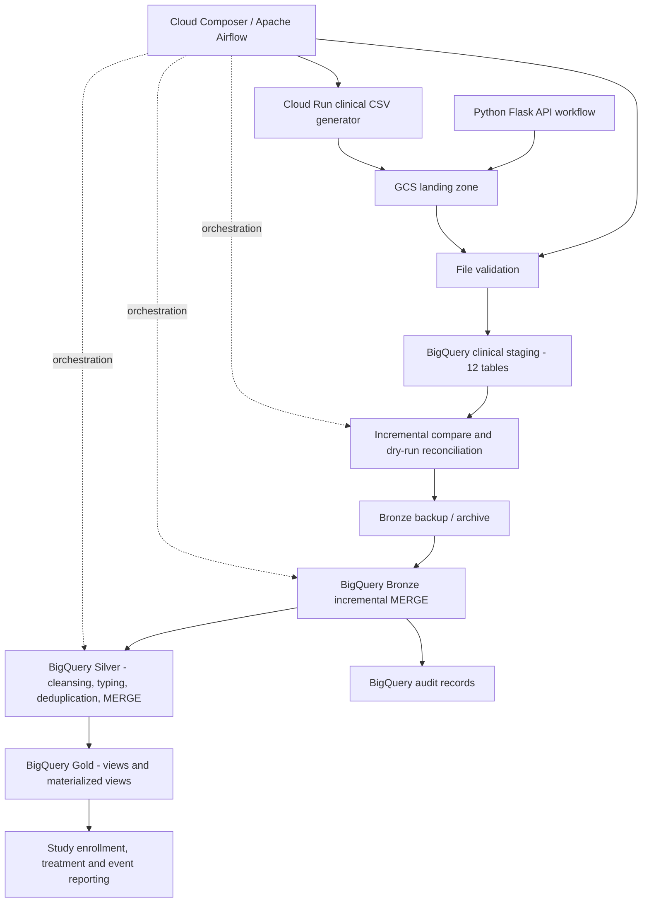

# Clinical Trial Data Platform | GCP

**An orchestrated, incremental clinical-data pipeline from ingestion to analytics-ready reporting.**

> **Project status:** Core pipeline implemented and tested with synthetic clinical data. This is a portfolio/reference implementation, not a claim of deployment into a live clinical sponsor's production environment.

## Executive summary

Clinical study teams need consistent, traceable information about patients, sites, enrollments, treatments, laboratory results and adverse events. Disconnected feeds and repeated full loads can delay reporting, introduce duplicates, and make changes difficult to audit.

This project implements a **12-table clinical data pipeline on Google Cloud Platform (GCP)**. A Cloud Run clinical data generator produces batch CSV feeds; Cloud Composer (Apache Airflow) orchestrates ingestion into Google Cloud Storage (GCS), BigQuery staging, incremental Bronze MERGE, curated Silver tables, and Gold reporting views. The pipeline includes file checks, comparison and dry-run reconciliation, pre-MERGE backup, and audit records.

### Business outcomes demonstrated

- **Reliable ingestion:** A complete 12-file batch is staged and compared before changes are applied.
- **Change-aware processing:** Records are classified as new, changed or unchanged; Bronze MERGE inserts or updates only when needed.
- **Traceability:** Batch-level and table-level audit information supports troubleshooting and reconciliation.
- **Analytics readiness:** Typed, deduplicated Silver data feeds study-enrollment and treatment-analysis reporting views.
- **Controlled execution:** Read-only and confirmed live execution paths reduce accidental changes during testing.

**Observed test batch:** 53,500 incoming rows across 12 CSVs; **1,652 new**, **3,858 changed**, **49,595 unchanged**. These counts come from a successful incremental test, not a production throughput benchmark. No measured cost-savings percentage, enterprise SLA, or latency improvement is claimed.

## Architecture



The Flask API workflow is a separate DAG branch. The 12-table incremental clinical path is driven by the Cloud Run generator. Gold views reference Silver tables; an explicit Gold refresh task has **not** been added to the DAG.

## Technology and design decisions

| Capability | Implemented technology | Why it was used |
|---|---|---|
| Clinical feed generation | Python, Cloud Run Job | Containerized, repeatable batch generation for the reference workload |
| API ingestion branch | Python, Flask | Separate API-based ingestion workflow |
| Landing zone | Google Cloud Storage | Durable batch files, decoupled from warehouse processing |
| Workflow orchestration | Cloud Composer / Apache Airflow | Dependencies, branching, scheduling, retries and task logs |
| Staging, Bronze, Silver, Gold | BigQuery | Serverless SQL processing and analytics |
| Incremental updates | BigQuery SQL `MERGE` | Upsert by primary key without indiscriminate full reloads |
| Data preparation | BigQuery SQL via Python | `TRIM`, `NULLIF`, `SAFE_CAST`, `ROW_NUMBER` and schema-driven mappings |
| Recovery and audit | BigQuery archive and audit datasets; GCS archive | Pre-update backup and per-batch processing evidence |
| Reporting | BigQuery views and materialized views | Reusable study and treatment reporting queries |

**Not claimed as implemented in this 12-table flow:** Pub/Sub streaming, Dataflow, Spark/Dataproc processing, Great Expectations, CMEK, quantified partition/clustering savings, or Unity Catalog. Those are possible extensions, not current project features.

## Dataset coverage

The clinical batch contains these 12 logical tables:

`adverse_events`, `clinical_sites`, `clinical_studies`, `investigators`, `lab_results`, `medical_history`, `medications`, `patient_enrollments`, `patient_visits`, `patients`, `study_treatments`, `vital_signs`.

Primary keys are defined per table in the incremental MERGE configuration. Related records are connected using study, patient, site, enrollment and visit identifiers where applicable.

## End-to-end workflow

1. **Generate and land:** Airflow triggers the Cloud Run Job, which writes 12 CSVs to `gs://personalproject_1/clinical_source/{batch_id}/`.
2. **Validate and stage:** Airflow checks the expected batch files and loads them into BigQuery staging tables.
3. **Compare:** SQL compares staged rows against Bronze by table-specific primary keys and source values; records are classified as new, changed or unchanged.
4. **Reconcile:** A dry-run MERGE result is checked against the comparison totals before live changes are allowed.
5. **Protect Bronze:** The existing Bronze state is archived before a live MERGE.
6. **Upsert Bronze:** BigQuery `MERGE` inserts new records and updates changed records; audit entries capture counts and execution results.
7. **Curate Silver:** A reusable Python module reads existing Silver schemas, generates cleansing/type-conversion SQL, deduplicates by primary key and MERGEs into 12 Silver tables.
8. **Serve Gold:** Standard views and materialized views provide analytics-oriented aggregations over Silver.

### Gold reporting objects

| Object | Purpose |
|---|---|
| `paraxel_gold.v_study_enrollment_summary` | Patients and clinical sites by study |
| `paraxel_gold.v_treatment_analysis` | Patients by study and treatment arm |
| `paraxel_gold.mv_study_enrollment_status` | Materialized study enrollment reporting |
| `paraxel_gold.mv_daily_event_monitoring` | Materialized daily event reporting |

The definitions of the two standard views were checked against `paraxel_silver`. Materialized views were observed to exist; their refresh behavior was not independently benchmarked.

## Orchestration and operational controls

**Airflow DAG:** `clinical_data_pipeline`  
**Composer environment:** `paraxelairflow` (`us-central1`)  
**GCP project:** `vaarahigcpproject`  
**Schedule:** `0 * * * *` (hourly)  
**Concurrency:** `max_active_runs=1`  
**Retries:** 2 with a 5-minute delay

The clinical branch follows:

```text
trigger_clinical_generator
  -> validate_clinical_files
  -> load_clinical_staging
  -> compare_clinical_incremental
  -> summarize_incremental_comparison
  -> merge_clinical_dry_run
  -> verify_merge_dry_run
  -> choose_merge_execution
     -> archive_bronze_before_merge
     -> merge_clinical_live
     -> process_clinical_silver
     -> end
```

The alternative `skip_live_merge -> end` branch is used for read-only execution. Supported modes are `normal`, `test_existing_batch`, and `apply_existing_batch` (the latter requires `confirm_live_merge=true`). The DAG also contains an independent Flask API ingestion branch.

### Run from Windows Google Cloud SDK CMD

```cmd
:: Trigger a new full run (writes data). Do not run if another execution is already active.
gcloud composer environments run paraxelairflow --location=us-central1 --project=vaarahigcpproject dags trigger -- clinical_data_pipeline --conf "{\"mode\":\"normal\"}"

:: Inspect DAG runs
gcloud composer environments run paraxelairflow --location=us-central1 --project=vaarahigcpproject dags list-runs -- -d clinical_data_pipeline

:: Inspect DAG tasks
gcloud composer environments run paraxelairflow --location=us-central1 --project=vaarahigcpproject tasks list -- clinical_data_pipeline
```

These commands require authenticated `gcloud`, Composer access, and appropriate IAM permissions. Triggering `normal` mode performs live data writes; use only in the intended environment.

## Reliability and troubleshooting examples

- **Invalid SQL type in Silver:** A generated `SAFE_CAST(... AS FLOAT)` failed because BigQuery expected `FLOAT64`. Correcting the type mapping and retrying only the Silver task allowed all 12 Silver MERGEs to succeed.
- **Queued DAG runs:** Airflow's pause state and the single-active-run configuration required attention before a new run could execute.
- **Partial task success:** Some Silver tables had already merged when a later table failed. Per-table `MERGE` operations were designed to be rerunnable without blindly appending duplicate keys. This does not imply all 12 tables are committed atomically as one transaction.
- **Recovery safeguards:** A Bronze archive and comparison-to-dry-run reconciliation precede live updates.

## Repository layout

```text
gcp-clinical-data-pipeline/
├── .github/workflows/           # Proposed CI workflows
├── airflow/
│   ├── dags/                    # clinical_data_pipeline.py
│   └── include/                 # Reusable ingestion, audit and transformation modules
├── cloud_run/clinical_data_generator/
├── sql/                         # Versioned Bronze/Silver/Gold SQL
├── config/                      # Non-secret environment settings
├── tests/                       # Unit and integration tests
├── scripts/                     # Deployment and run helpers
├── docs/                        # Architecture and operational guides
└── README.md
```

**Deployment note:** The current Composer DAG imports helper modules from the Composer DAGs directory. Moving files into `airflow/include/` requires corresponding import/package and deployment changes; do not restructure the live Composer bucket without testing.

## Security, limitations and next steps

This reference project uses **synthetic clinical data** and must not be represented as processing real patient records. Before using real protected health information, review applicable privacy requirements, service-account least privilege, access policies, retention, audit access, encryption/key management and sensitive-data handling.

Potential future work includes CI/CD tests, automated data-quality thresholds for failed `SAFE_CAST`s, stronger schema contracts, documented partition/clustering benchmarks, controlled deployment environments, and explicit operational monitoring. These are **recommendations**, not completed features.

## For stakeholders

The project demonstrates a reproducible path from raw clinical feeds to auditable, business-oriented reporting tables. Its primary value is **traceable incremental processing, controlled updates, and reusable analytics views**, rather than unverified claims about production scale or cost savings.
